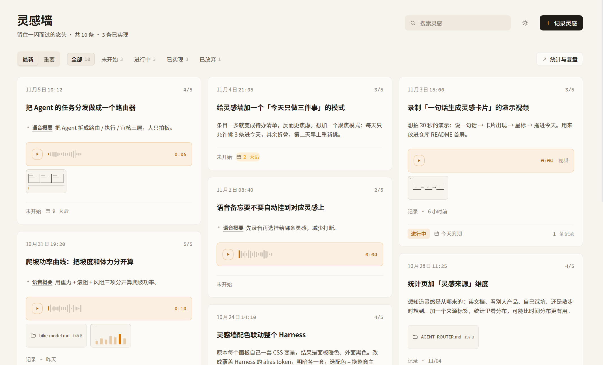

# dsh-inspiration-wall

[中文](README.md) ｜ **English**

> **This is an unofficial project.** It is not affiliated with, endorsed by, or supported by DeepSeek.

> A local-first idea wall that lives in the dsh sidebar: jot down whatever just crossed your mind — text, voice, screenshots, video and arbitrary files can share one note — then track how (and whether) each idea becomes a demo, plus how many tokens it really cost on this machine.



`local-first` · `zero tokens` · `MIT` · `installs as a Cordis bundle`

It sits in the left navigation right below **Automation tasks**, next to *Plugins*.

---

## What it is

An idea-capture panel that runs inside your own dsh. It never calls a model, never spends tokens and never uploads anything: everything is written to `~/.dsh/inspiration/` on this machine and survives restarts.

## What it solves

| The usual friction | What the wall does |
| --- | --- |
| Ideas scatter across chats, notes apps and voice memos | One note = text + voice + images + video + files, all attached together |
| A voice memo has to be replayed to remember it | Transcribed locally into an editable "voice content" box, plus one auto-distilled **summary** shown on the card |
| You forget what you committed to | 1–5 stars and four statuses; sort by importance to work top-down |
| No record of how far an idea got | Add a **record** at any time (progress, blocker, next step) and get a timeline |
| No sense of your own shipping rhythm | Insights: idea bursts, implementation dates, idea-to-demo interval, streaks |
| No idea what all this work costs | The Token tab reads real usage from local session logs and prices it at your rates |

## Screens

**The wall**: a three-column masonry. `n/5` in the top-right corner is the importance rating; the footer row reads "status -> expected date -> record count", and the last column ends with a week-in-review card.

> The screenshot above is v0.7.5 running inside dsh (paper palette, 10 sample notes). The compose sheet, note detail, insights and token pages are not illustrated.

## Features

- **One note, every medium.** Text plus any mix of voice (`MediaRecorder`), images, video and arbitrary files; drop files anywhere on the editor.
- **Summary is not the transcript.** Speech is transcribed locally into an editable *voice content* box (the audio bytes stay untouched), while a separate local extractive summarizer produces the one-line summary that the card shows.
- **Stars and sorting.** 1–5 stars (5 = most important), rendered as `n/5`; sort by newest or by importance, with live counts per category.
- **Four categories.** Not started / In progress / Implemented / Dropped. Legacy names (新想法, 思路, 待验证) migrate automatically.
- **Records and completion.** Any note accepts records at any time, with optional attachments; marking a note done writes a completion record that may carry result links and a retrospective — all optional.
- **Expected date.** Set next to the recorded-at field; the card shows a chip (overdue / today / soon).
- **Attachment actions.** Left-click previews; right-click opens in browser, opens with the OS default app, reveals in folder, or copies the path.
- **Real token usage.** Today / this week / this month / last 90 days / custom range, with daily trend, per-model split and a daily table.
- **Three palettes that re-theme the whole dsh.** Paper (default), Graphite, Ember. A palette overrides the dsh alias tokens (light and dark separately), so picking one inside the wall re-themes the entire dsh window.
- **Chinese and English.** The panel follows the dsh UI language (other languages fall back to English); dates, relative times and category names switch together, stored values never change.
- **Entirely local.** Capture, recording, transcription, uploads and previews all run on this machine.

## Requirements

- dsh with the bundled plugin manager (`plugin_manager`) — the panel is a Cordis bundle.
- Node.js ≥ 18, only to rebuild the client bundle.
- A microphone for voice notes. Transcription needs the dsh speech service; without it recording and playback still work.

## Install

```bash
git clone https://github.com/whalealpha/dsh_inspiration_wall.git
```

Then ask the agent in dsh to install the local directory:

```jsonc
{ "action": "install_bundle", "target": "C:/path/to/dsh_inspiration_wall" }
```

The bundle is link-installed: after editing `src/`, run `node build.mjs` and reload the plugin; a change to `index.js` (host half) needs an app restart. Upgrade, uninstall and troubleshooting: [docs/install.md](docs/install.md).

## Cheat sheet

| Do this | You get |
| --- | --- |
| Click **New note** | Editor: title, body, attachments, category, stars, tags, recorded-at, expected date |
| Drop files on the editor | They upload and attach to the note |
| Click a card | Detail: attachments, summary, record timeline, status bar, completion card |
| **Add record** | Append a progress record (text + optional attachments) at any time |
| **Complete** | Completion form: completion time, result links, retrospective (all optional) |
| Star icons | Re-rank; pair with importance sorting to work top-down |
| **Insights** | Overview and token tabs for the chosen period |
| Gear icon | Palette, media directory, token prices, transcription, default period |
| Sun icon | Palette picker — re-themes the whole dsh |
| Right-click an attachment | Browser / default app / reveal in folder / copy path |

## Where the data lives

```
~/.dsh/inspiration/
├── notes.json        # all notes, records and attachment metadata (schema v2)
├── settings.json     # palette, prices, media dir, transcription, default period
└── media/            # recordings, images, video and files (or your custom media dir)
```

Copy that folder to back everything up. Full schema: [docs/data-model.md](docs/data-model.md).

## Known limitations

- **Token usage is read, not measured.** Numbers come from the local profile's session logs, so rotated-away sessions or sessions in another profile are not included.
- **Transcription is a dsh service.** Without it, voice notes still record and play; the panel shows a failure toast instead of text.
- **Electron blocks `window.open`.** "Open in browser" therefore falls back to the host half, which hands the local URL to the operating system.
- **One panel, one user.** No sync, no accounts, no sharing; the JSON file is the whole state.

## Documentation

| Document | Contents |
| --- | --- |
| [docs/introduction.md](docs/introduction.md) | Project introduction with images (Chinese) |
| [docs/install.md](docs/install.md) | Install / upgrade / uninstall / troubleshooting |
| [docs/usage.md](docs/usage.md) | Every feature, screen by screen |
| [docs/demo.md](docs/demo.md) | Visual tour |
| [docs/architecture.md](docs/architecture.md) | Host half, client half, slots, HTTP API |
| [docs/data-model.md](docs/data-model.md) | `notes.json` / `settings.json` / media files |
| [docs/versions.md](docs/versions.md) | Version management and rollback |
| [CHANGELOG.md](CHANGELOG.md) | Release history |

## Development

```bash
node build.mjs                  # src/*.js -> client.js (the single module the dsh loads)
node --check client.js
node check.mjs                  # i18n key coverage + pure-function unit checks
node scripts/verify-v05.mjs
node scripts/verify-v051.mjs
node scripts/verify-v07.mjs     # palettes, locale formatting, card layout
node scripts/verify-i18n.mjs    # renders every panel in zh + en, checks for language leaks
node scripts/ui-smoke.mjs       # renders every React component with a stub React
node scripts/label-check.mjs    # button wording / duplicate-action guard
node scripts/host-selftest.mjs
```

`client.js` is generated but **committed on purpose**: the dsh loads it directly and a link-installed bundle ships whatever is in the working tree. Rebuild before every commit.

Contributions: [CONTRIBUTING.md](CONTRIBUTING.md).

## License

[MIT](LICENSE) © 2026 dsh-inspiration-wall contributors