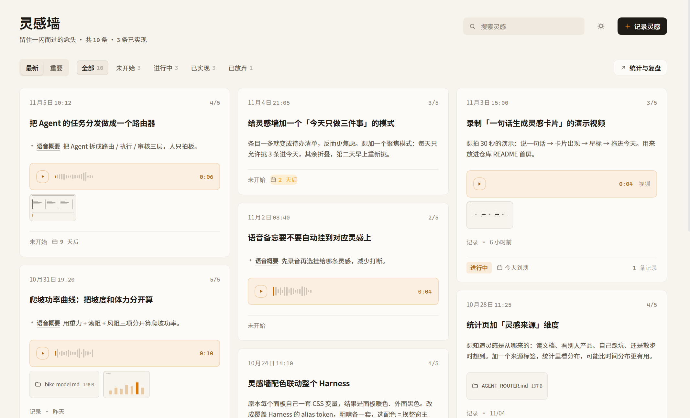

# 灵感墙 · dsh-inspiration-wall

**中文** ｜ [English](README.en.md)

> **本插件为非官方项目**，与 DeepSeek 官方无关；纯个人项目，按 MIT 开源分享。

> 长在 dsh 左侧栏里的本地便签墙：想到什么随手记下（文字、录音、截图、视频、任意文件可以混在同一条里），之后按星级和状态推进，回头能看见「从灵感到 Demo 花了多少天」，以及这台机器真实消耗了多少 token。



`本地优先` · `零 token` · `MIT` · `以 Cordis bundle 装进 DSH`

挂在左侧导航 **自动化任务** 下面，和「插件」并列的一个入口。

---

## 这是什么

一个跑在你自己的 dsh 里的灵感收集面板。它不联网、不调模型、不花 token：所有内容写在本机 `~/.dsh/inspiration/` 里，关掉应用也还在。

## 它解决什么问题

| 平时遇到的麻烦 | 灵感墙的做法 |
| --- | --- |
| 灵感散在聊天记录、备忘录、语音备忘里，找不到 | 一条灵感 = 文字 + 声音 + 图片 + 视频 + 文件，全部挂在同一条下 |
| 语音备忘要重听才知道说了什么 | 本机转写成可编辑的「语音内容」，另自动提炼一句**概要**显示在卡片上 |
| 记完就忘，不知道有没有做 | 5 档星级 + 4 个状态，按「重要」排序就能每天只推进最要紧的 |
| 想法推进到哪一步没有记录 | 随时写「记录」（进展 / 卡点 / 下一步），形成时间线 |
| 不知道自己的产出节奏 | 统计页：灵感迸发分布、实现分布、灵感到 Demo 的间隔、连续记录 |
| 想估算「做这些事花了多少钱」 | Token 页直接读本机会话日志里的真实用量，按你的单价折算成本 |

## 界面

**主界面**：三列瀑布流。卡片右上角是 `n/5` 星级，底部一行「状态 → 期待日期 → 记录数」，第三列末尾固定一张本周回顾卡。

> 上图为 dsh 中 v0.7.5 的实际运行截图（暖纸配色，数据取自 10 条示例灵感）。记录弹层、灵感详情、统计与复盘、Token 消耗四页不再单独配图。

## 功能

- **一条记录装下所有媒介**：文字 + 录音 / 图片 / 视频 / 任意文件混排；支持整窗拖拽上传。
- **语音概要 ≠ 转写**：转写进「语音内容」框（可改，不动录音字节）；概要由本地抽取式算法生成，卡片只显示概要。
- **星级与排序**：1–5 星（5 最重要），卡片头部 `n/5`；支持「最新 / 重要」两种排序与分类筛选计数。
- **四个分类**：未开始 / 进行中 / 已实现 / 已放弃。旧分类（新想法、思路、待验证）自动迁移。
- **记录与完成**：任意灵感随时追加「记录」（可带附件）；标记完成时写「完成记录」，可填结果链接与思考复盘，也可留空。
- **期待实现日期**：编辑页在「记录时间」右侧设置，卡片以角标提示（已过期 / 今天 / 临近）。
- **附件操作**：左键预览，右键「浏览器打开 / 默认程序打开 / 在文件夹中显示 / 复制路径」。
- **真实 Token 统计**：今天 / 本周 / 本月 / 近 90 天 / 自定义起止，按日趋势 + 模型分布 + 明细。
- **三套配色联动整个 dsh**：暖纸（默认）、石墨、碳棕。配色不是面板内换肤，而是覆盖 dsh 的 alias token（明暗各一套），所以**在灵感墙里选配色，整个 DSH 窗口一起变**。
- **中英双语**：跟随 DSH 界面语言，其它语言回落英文；日期、相对时间、分类名一起切换，存储值不变。
- **完全本地**：新增、录音、转写、上传、预览都在本机完成，从不调用大模型。

## 安装

需要 dsh（带 `plugin_manager` 工具）与 Node.js ≥ 18（仅用于重建客户端）。

```bash
git clone https://github.com/whalealpha/dsh_inspiration_wall.git
```

然后在 DSH 里让 Agent 安装本地目录：

```jsonc
{ "action": "install_bundle", "target": "C:/path/to/dsh_inspiration_wall" }
```

安装是**链接式**的：改完 `src/` 执行 `node build.mjs`，再让 Agent 重载插件即可；改动 `index.js`（Host 半）后需重启应用。升级、卸载与排错见 [docs/install.md](docs/install.md)。

## 使用速查

| 操作 | 结果 |
| --- | --- |
| 点「记录灵感」 | 打开编辑器：标题、正文、附件、分类、星级、标签、记录时间、期待日期 |
| 把文件拖进编辑器 | 自动上传并挂到这条灵感 |
| 点卡片 | 打开详情：附件、概要、记录时间线、状态栏、完成入口 |
| 「记录」 | 随时追加一条进展记录（文字 + 可选附件） |
| 「完成灵感」 | 完成表单：完成时间、结果链接、思考复盘（可留空） |
| 点卡片星标 | 改星级；配合「重要」排序自上而下推进 |
| 「统计与复盘」 | 统计总览 + Token 消耗两个页签 |
| 齿轮图标 | 配色、媒体目录、Token 单价、转写开关、默认统计周期 |
| 太阳图标 | 配色选择器（改的是整个 dsh 的主题） |
| 附件上右键 | 浏览器打开 / 默认程序 / 在文件夹中显示 / 复制路径 |

## 数据在哪

```
~/.dsh/inspiration/
├── notes.json        # 全部灵感、记录与附件元数据（schema v2）
├── settings.json     # 配色、单价、媒体目录、转写、默认周期
└── media/            # 录音、图片、视频、文件（也可改到自定义目录）
```

备份直接拷这个目录；完整字段见 [docs/data-model.md](docs/data-model.md)。

## 已知限制

- **统计只读本机日志**：会话被轮转删除、或位于其它 profile 的用量不会计入。
- **转写依赖 dsh 语音服务**：没有语音服务时，录音仍可录制与播放，只是不能转写（面板会提示）。
- **Electron 拦截 `window.open`**：所以「浏览器打开」会回落到 Host 半，由系统浏览器打开本地 URL。
- **单机单用户**：没有同步、没有账号、没有分享，一个 JSON 文件就是全部状态。

## 文档

| 文档 | 内容 |
| --- | --- |
| [docs/introduction.md](docs/introduction.md) | 项目介绍与全部配图 |
| [docs/install.md](docs/install.md) | 安装 / 升级 / 卸载 / 排错 |
| [docs/usage.md](docs/usage.md) | 逐屏功能说明 |
| [docs/demo.md](docs/demo.md) | 视觉走查 |
| [docs/architecture.md](docs/architecture.md) | Host 半、Client 半、槽位与 HTTP API |
| [docs/data-model.md](docs/data-model.md) | `notes.json` / `settings.json` / 媒体文件 |
| [docs/versions.md](docs/versions.md) | 版本管理与回滚 |
| [CHANGELOG.md](CHANGELOG.md) | 更新记录 |

## 开发

```bash
node build.mjs                  # src/*.js -> client.js（dsh 直接加载的单模块）
node --check client.js
node check.mjs                  # 中英词典完整性 + 纯函数单测
node scripts/verify-v05.mjs
node scripts/verify-v051.mjs
node scripts/verify-v07.mjs     # 配色、日期本地化、卡片布局
node scripts/verify-i18n.mjs    # 中英各渲染一遍，检查语言泄漏
node scripts/ui-smoke.mjs       # 用 React stub 渲染全部组件
node scripts/label-check.mjs    # 按钮文案与重复动作检查
node scripts/host-selftest.mjs
```

`client.js` 是构建产物，但**故意入库**：dsh 直接加载它，链接安装的 bundle 用的是工作区里的文件。提交前请先重建。

贡献指南：[CONTRIBUTING.md](CONTRIBUTING.md)。

## 许可证

[MIT](LICENSE) © 2026 dsh-inspiration-wall contributors