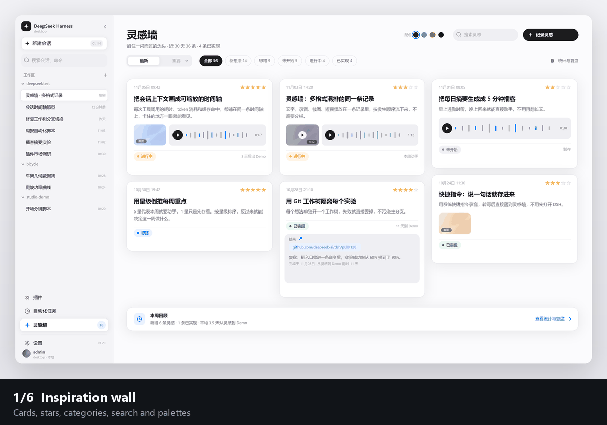
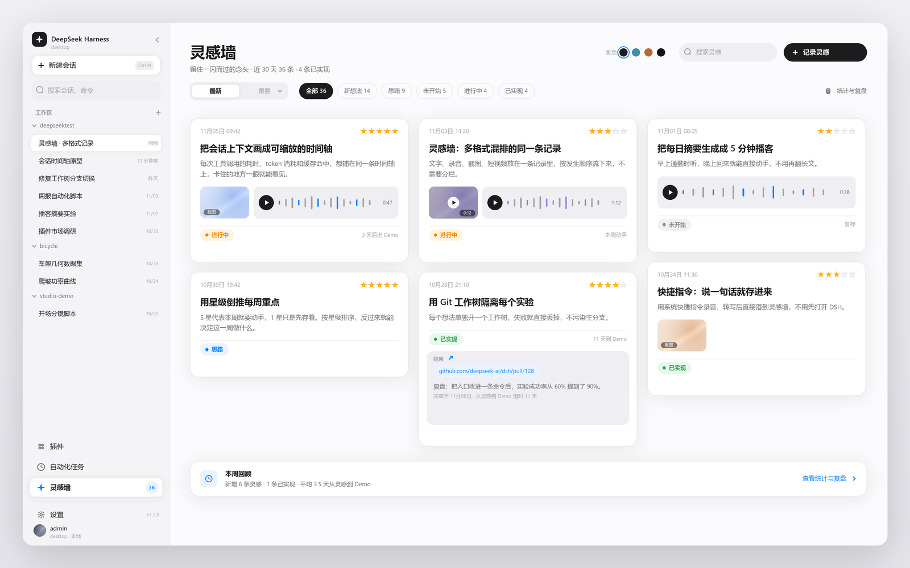
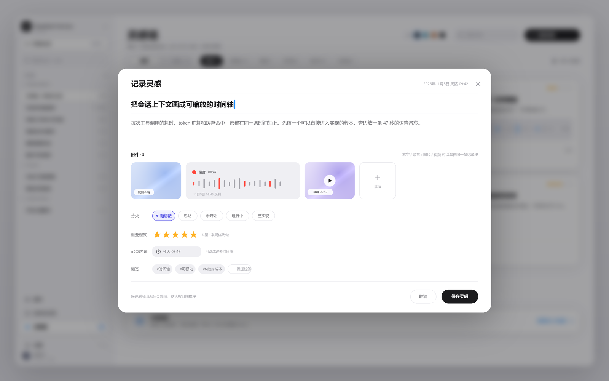
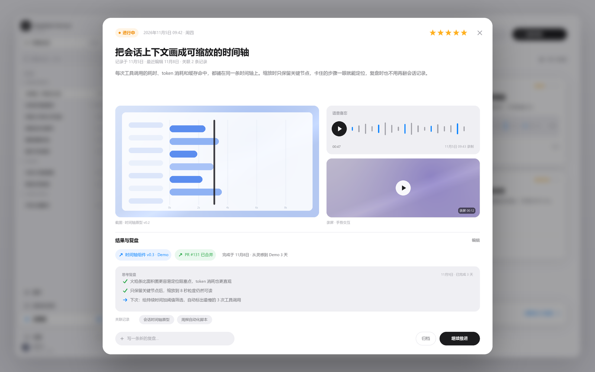
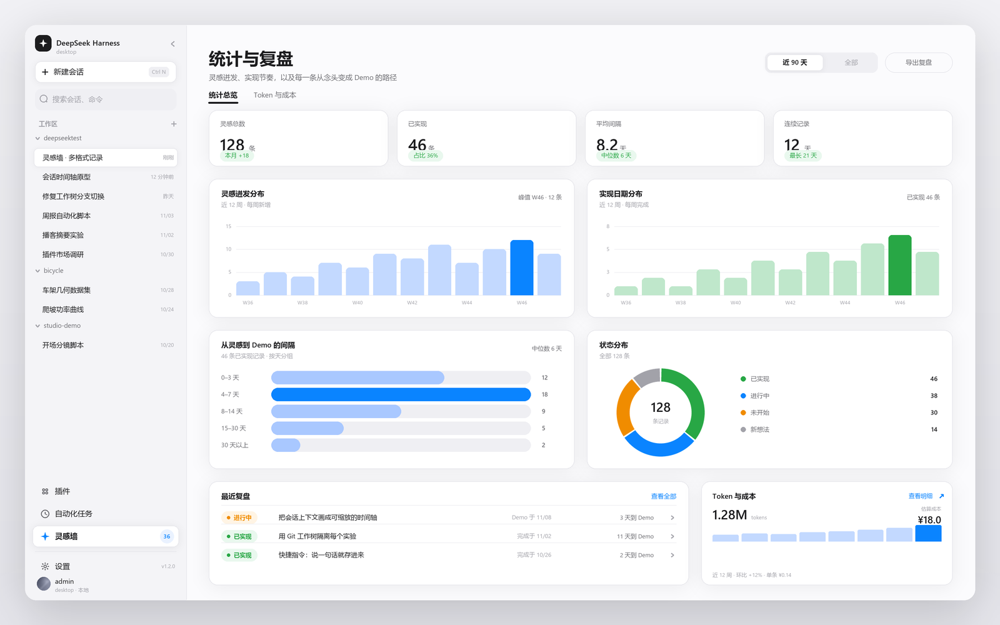
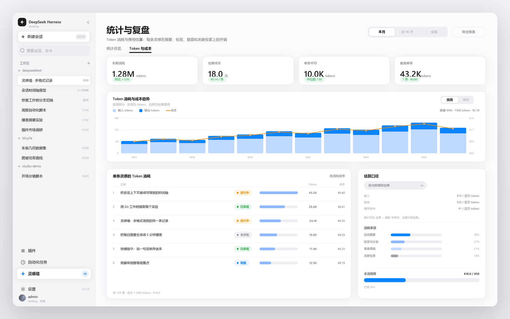
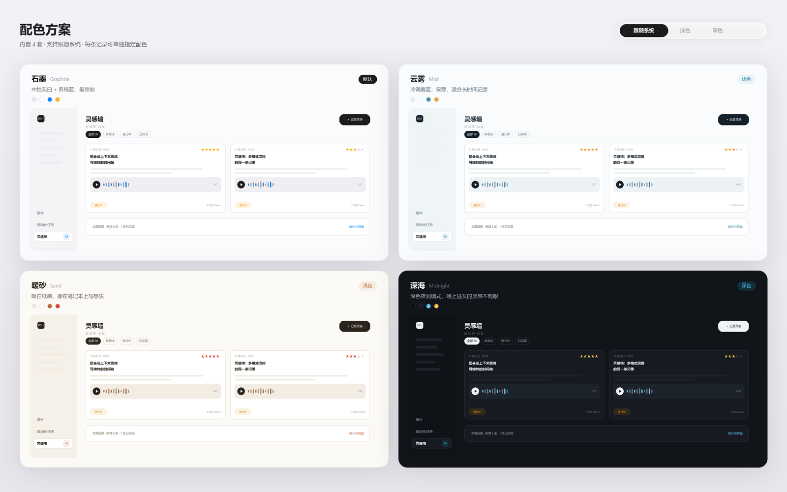

# Demo

A visual tour of the panel. The images below are the **design boards** produced while the layout was being settled
(the shipped UI follows them), plus a captioned tour GIF assembled from the same boards.

> These boards date from `v0.1` and predate two later decisions, so a few labels differ from the shipped panel:
> the category row shows the original five names (`新想法 / 思路 / 未开始 / 进行中 / 已实现`) while the panel now ships
> four (`未开始 / 进行中 / 已实现 / 已放弃`), and the record section is still labelled **复盘 / Retrospective** where the
> panel now says **记录 / Records**. Layout, spacing, stars, chips and palettes are what the panel actually renders.

## The wall

Left navigation gains one entry, **灵感墙 / Inspiration wall**, directly below *Automation tasks*. The header carries
search, palette dots, settings and *New note*; the row below carries the sort switch, category filters with counts and
the insights link. Cards show date + stars, title, summary, media, latest record, category and expected-date chip.

## One note, every medium

A single note holds text plus voice, image, video and arbitrary files. Voice becomes editable text plus a locally
derived summary; a "+" tile adds more attachments.

## Note detail

Attachments on the left, media and voice on the right, then results and the retrospective, then the related records.
The record composer at the bottom writes progress at any time.

## Insights

Idea distribution per week, implementation distribution per week, idea-to-demo interval buckets with a median, status
donut, and the recent reviews list.

## Real token usage

Actual input / output / cache-hit tokens from the local session logs, per day, priced with your own rates. Range can be
a preset or a custom start–end pair.

## Palettes

Graphite (default), Mist, Sand, Midnight, Cyber, Ember.

## A two-minute walkthrough

1. Click **记录灵感 / New note**, type a title, and drop a screenshot onto the editor. Pick a category, set 4 stars,
   optionally set an expected date. Save — the note appears on the wall; **it does not jump into a review form**.
2. Click the card. The detail opens with the screenshot previewable. Right click it → *Open in browser* (or *Open with
   default app*) to inspect it outside the panel.
3. Click **记录 / Add record**, write what you tried today, attach a screen recording, save. The timeline shows it, and
   the card's footer starts showing the record count.
4. Click **完成灵感 / Complete**. Set the completion date, paste the demo/PR links, write two lines of retrospective —
   or skip it. The note turns *Implemented*, the wall shows `3 days to demo`, and the interval is frozen.
5. Open **统计与复盘 / Insights**. Check the interval buckets and the weekly rhythm, then switch to **Token 与成本** to see
   how much this week's work actually cost at the terminal, priced with your own rates.
6. Switch palette from the dots in the header and confirm the panel alone changes; open settings to point the media
   directory at a bigger disk if you attach a lot of video.

## What is not in the demo

- No live screen recording of the running app is included: the environment used to build this bundle has no browser
  capture. The boards above are the authoritative reference for layout.
- The voice transcription step is shown as a finished state; the actual transcription depends on your dsh speech
  service being installed.