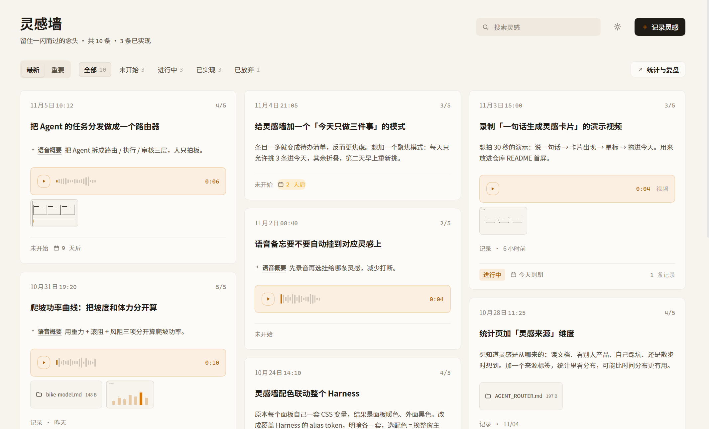

# 灵感墙 · 项目介绍

> 一个长在 dsh 左侧栏里的灵感便签墙：想到什么随手记下（文字、录音、截图、视频、任意文件可以混在同一条里），之后按星级和状态推进，回头还能看见"从灵感到 Demo 到底花了多少天"，以及这些想法真实消耗了多少 token。

当前版本 **0.7.5** ｜ MIT ｜ 以 Cordis bundle 形式安装到 DSH

> **关于配图**：本页只保留一张主界面截图，为 v0.7.5 在 dsh 中的真实运行（暖纸配色，数据取自 10 条示例灵感）。



---

## 一、它是做什么的

一句话：**给"还没成形"的想法一个不必立刻做完的地方。**

灵感和任务是两种东西。任务有截止日期、有负责人、有验收标准；而灵感往往只有半句话、一段 40 秒的语音、一张截图，甚至只是"这个交互好像可以试一下"。用任务工具记它，会被逼着填一堆此刻答不上来的字段；用纯文本记它，过两周就再也回不去当时的语境。

灵感墙就是一个纯粹的落点：

- **一条记录 = 一个想法**，可以是纯文字，也可以文字 + 语音 + 截图 + 视频 + 附件混排；
- **有状态，但不逼你现在决定**——默认「未开始」，想推进了再改成「进行中」；
- **完成后可以挂结果**，并留下一条复盘记录；
- **所有数据留在本机**，记一条灵感的成本是 0 token。

---

## 二、它解决什么问题

| 现实里的问题 | 灵感墙的做法 |
|---|---|
| 想法是语音/截图/视频形态的，纯文本记不住 | 一条记录里可以混排文字、录音、图片、视频、任意文件，按发生顺序排列 |
| 语音转写完整段话，卡片上却只能放摘要 | **转写**和**概要**分成两个字段：转写是"语音内容"（可编辑，不动原始录音），概要是本地算法压出的一句核心意思，卡片只显示概要 |
| 记完就石沉大海，不知道哪些真的做了 | 状态流转 + 「N 天后出 Demo」+ 统计页的低头曲线 |
| 复盘写在别处，和当时的记录对不上 | 结果链接和复盘记录挂在原记录下方，`完成` 时才出现复盘表单 |
| "我这周到底想了几件事"说不清 | 统计页：灵感迸发分布、实现日期分布、灵感到 Demo 间隔、连续记录天数 |
| 想知道这些想法花了多少钱 | Token 页直接读本机会话日志，按真实 usage 统计，不是估算 |
| 皮肤和主程序不搭 | 面板里选配色，**整个 DSH 一起换** |

---

## 三、特色

### 1 · 多格式混排在同一条记录里

文字、录音、截图、视频、任意文件都能塞进同一条灵感，卡片上按顺序排开：音频和视频统一渲染成"录音磁带"样式（真实波形 + 等宽时间码），图片是缩略图，文件是带大小和下载的条目。

### 2 · 语音：转写归转写，概要归概要

录完音会自动本地转写（SenseVoice，纯本机，不联网）。转写结果进入「语音内容」框，你可以直接改错字——**改的只是文字，原始录音字节不动**。同时本地算法（分句 → 词频打分 → 位置加权）压出一句概要，卡片上只显示这句概要。

这样卡片保持安静，点进详情又能看到/编辑全文。

### 3 · 记录时间线，而不是一次性复盘

每条灵感下面是一条可追加的时间线：卡住了、想通了、换方案了，随时写一条，可以附图片/视频/文件。完成时那一条叫「完成记录」，其余都是「记录」。

### 4 · 期待实现日期

记灵感时可以顺手填「期待实现日期」，卡片上会显示「3 天后 / 已逾期」的轻量提示，详情页会高亮这个日期。它不是 deadline，是"我希望什么时候看到东西"。

### 5 · 统计与复盘

- 四个 KPI：灵感总数、已实现、**平均间隔**、连续记录天数
- 灵感迸发分布（按周）
- 灵感到 Demo 的间隔分桶（0–3 / 4–7 / 8–14 / 15–30 / 30+ 天）
- 状态分布环形图、最近记录列表、一键导出 Markdown 复盘

### 6 · Token 与成本：统计真实消耗

这一页统计的不是"这条灵感值多少 token"，而是**DSH 终端在这一段时间里真实消耗了多少**：宿主侧读取本机会话日志里每条 `assistant/message` 的 usage（输入 / 输出 / 缓存命中），按自然日归桶，按模型汇总，再按设置里的单价折算成本（默认 输入 ¥2 / 输出 ¥8 / 缓存 ¥1 每百万 token，可改）。

范围可选今天 / 本周 / 本月 / 近 90 天 / 自定义起止日期；带会话级缓存，增量扫描。

### 7 · 三套配色，切换后整个应用一起变

暖纸（默认，暖白纸感 + 琥珀强调色）、石墨（中性灰白 + 系统蓝）、碳棕（深色暖棕）。

实现方式不是给面板单独上色，而是覆盖 dsh 的 14 个 `--dsw-alias-*` 设计 token（每套都给了 light / dark 两份），所以侧栏、会话、按钮会**同时**跟着变。


### 8 · 中英双语，跟随 DSH 语言

面板语言跟随 DSH 的界面语言：中文 / English。连日期格式（`11月05日 09:42` ↔ `Nov 5 · 09:42`）、相对时间、分类名、导出内容都会一起切换。数据里存的仍是同一份值，只是显示不同。

### 9 · 本地优先

- 记录与附件全部存本机（默认 `~/.dsh/inspiration/`，媒体目录可改）
- 录音转写走本机 SenseVoice 模型
- 记灵感、传附件、改状态、写记录：**0 token**
- 唯一联网的地方是 DSH 自身与你对话（以及 Token 页读取本机日志，也不联网）

---

## 四、快速开始

```bash
git clone https://github.com/<you>/dsh-inspiration-wall.git
```

在 DSH 里安装（宿主侧 `plugin_manager`，指向克隆下来的**目录**）：

```
install_bundle  target = C:\path\to\dsh-inspiration-wall
```

装好后左侧栏「自动化任务」下面会出现**灵感墙**。数据目录：`~/.dsh/inspiration/`（`notes.json`、`settings.json`、`media/`）。

卸载不会删数据；换机时把整个目录拷走即可。

详细安装与排错见 [install.md](install.md)，逐项功能见 [usage.md](usage.md)，数据结构见 [data-model.md](data-model.md)。

---

## 五、它不做什么

- 不做多人协作 / 云端同步（单机单用户）
- 不做提醒推送（期待日期只是视觉提示）
- 不做 AI 摘要（概要是本地算法，不消耗 token）
- 不替代待办工具（这里没有子任务、没有依赖关系）

---

## 六、版本

| 版本 | 要点 |
|---|---|
| 0.7.4 | 配色收敛为三套（暖纸 / 石墨 / 碳棕），其余配色保留代码但不再出现在界面 |
| 0.7.3 | 深色磁带抬升、卡片记录行改为安静文本 |
| 0.7.2 | 修复深色下磁带"塌成黑洞"（对比度 1.10:1） |
| 0.7.1 | 修复 Token 页「今天/本周」残留英文；新增 i18n 一致性回归脚本 |
| 0.7.0 | 主区视觉重做（案头工作台）、English UI、配色联动整个 DSH |
| 0.6.x | 打包开源版：MIT、文档、快照、`npm run snapshot` |
| 0.5.x | 期待日期、附件预览/右键打开、语音概要压缩、Toast 修复 |

完整记录见 [../CHANGELOG.md](../CHANGELOG.md)，回滚流程见 [versions.md](versions.md)。