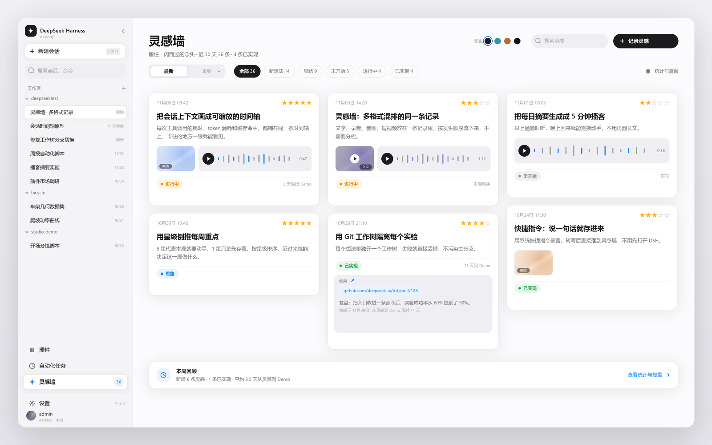
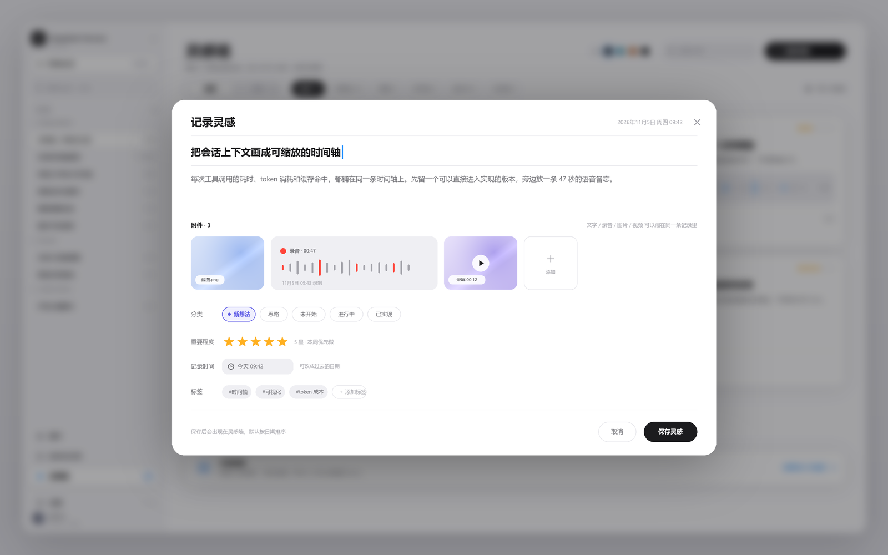
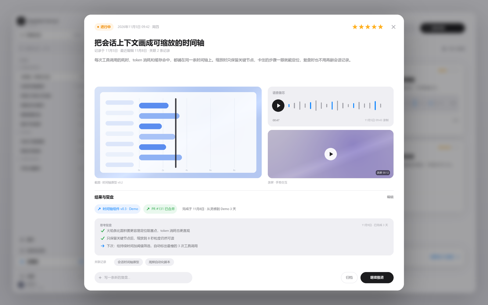
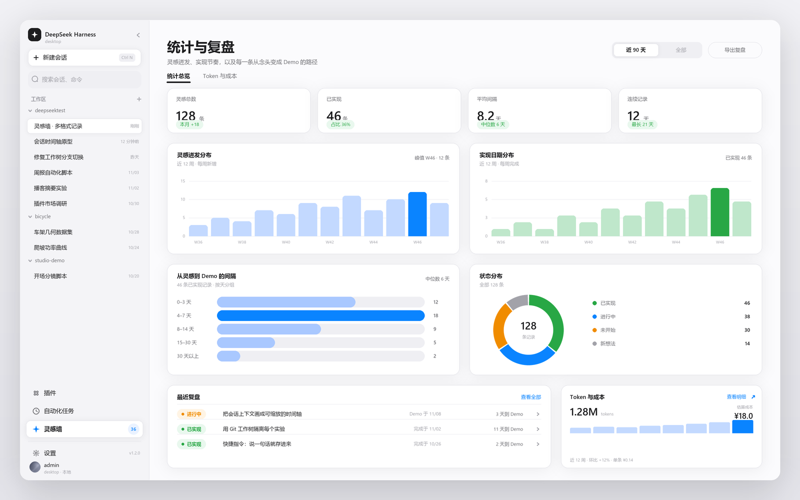
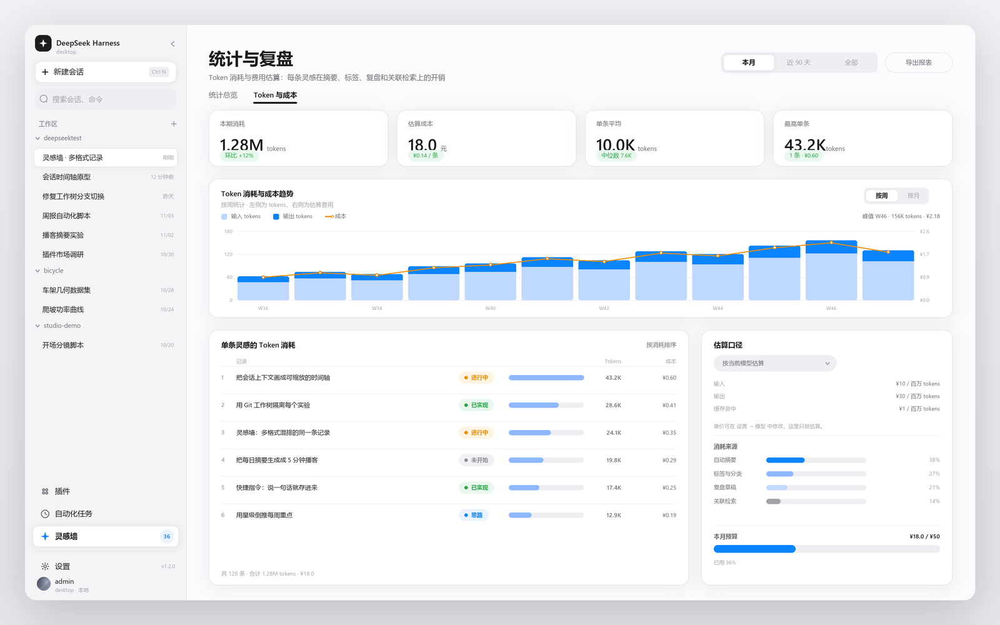
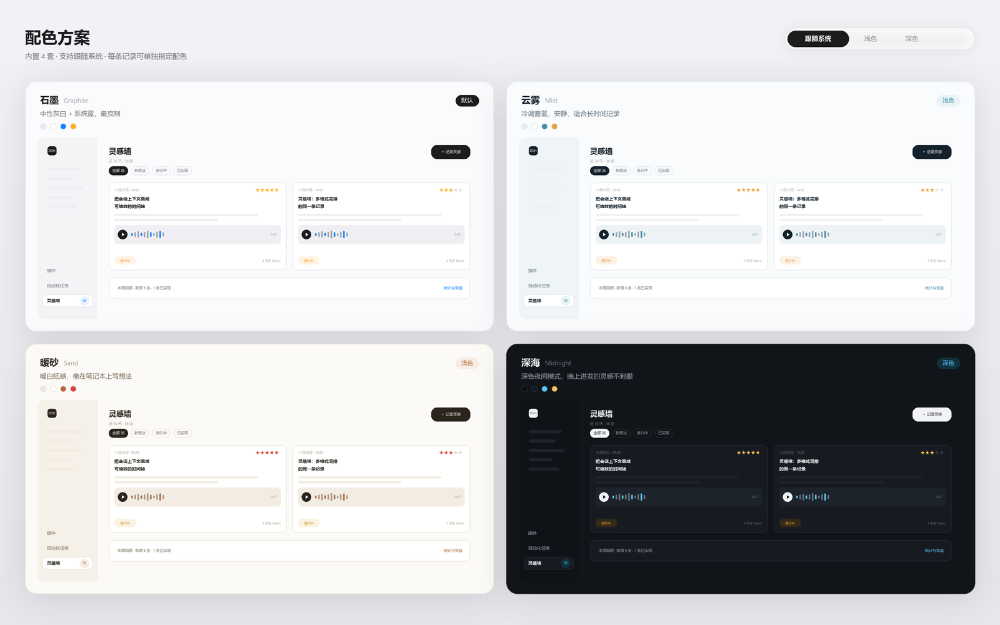

# Using the inspiration wall

Everything here happens locally. Nothing you do in this panel calls a language model or spends tokens.

## 1. The wall



The header shows the note count and how many are implemented, a search box, a sun button (palette picker), a settings button and
**New note**. Below it: the sort switch (`Latest` / `Importance`), category chips with live counts, and the insights
link.

Cards are masonry tiles. Top row of a card: recorded date and 1–5 stars. Then the title, then the **summary** (or the
body when there is no summary), then a media strip, then the most recent record, then the footer with the category
chip, the expected-date chip, and an implementation hint (`3 days to demo`) once the note is complete.

Sorting by **Importance** puts the highest-star notes first and breaks ties by newest — the intended weekly workflow is
to star what you actually want to do this week and work down the list.

## 2. Writing a note



- **Title** — short and specific; it is what you scan on the wall.
- **Body** — the reasoning, links, context.
- **Attach** — four buttons: record voice, image, video, file. Or drop files anywhere on the editor; images, video,
  audio and arbitrary files are all accepted (image ≤ 12 MB, video ≤ 80 MB, audio ≤ 30 MB, other files ≤ 50 MB each).
- **Category** — Not started / In progress / Implemented / Dropped.
- **Importance** — 1–5 stars.
- **Tags** — comma separated, used by search.
- **Recorded at** — defaults to now, editable so you can backfill an idea you had earlier.
- **Expected date** — optional; drives the card chip and the overdue hint.

**Voice.** Press record, speak, press stop. The recording uploads and, if *Voice auto transcription* is on, is
transcribed locally. Two text boxes follow:

| Box | What it is | Can you edit it |
| --- | --- | --- |
| **Voice content** | the full transcript of that recording | yes, any time; the audio itself never changes |
| **Summary** | a compressed gist derived locally from the transcript | yes; editing it stops auto-regeneration |

The summary is what the wall card shows, which is why a five-minute rambling voice memo still becomes a readable card.

## 3. A note's detail



Opened by clicking a card. Top to bottom: status bar (three persistent statuses plus a *more* select for
*Dropped*), title, body, summary box, attachments, progress timeline, record composer, completion card, footer.

- **Status bar** — clicking `Not started / In progress / Implemented` moves the note into that queue immediately.
  Choosing *Implemented* opens the completion form.
- **Attachments** — left click previews (image/lightbox, video player, audio player, file info), right click opens the
  action menu: *Preview*, *Open in browser*, *Open with default app*, *Reveal in folder*, *Copy path*.
- **Progress timeline** — one entry per record, newest first, with its own attachments. Records can be deleted
  individually (confirmation required).
- **Record composer** — write progress, blockers, or a thought; attach images/video/files by button or drag and drop.
- **Completion card** — the single place to mark a note done. Completion time (defaults to now), result links
  (name + URL, several allowed), retrospective text. Everything except the timestamp is optional, and *Skip
  retrospective and complete* finishes without writing one.

Once a note is implemented, its interval is frozen: the wall and the charts both use the completion record's
`implementedAt`.

## 4. Insights



Two tabs. **Overview**:

- **Idea distribution** — new notes per week for the last 12 weeks, with the peak week highlighted.
- **Implementation distribution** — completed notes per week.
- **Idea-to-demo interval** — buckets (`0–3`, `4–7`, `8–14`, `15–30`, `30+` days) with median and average.
- **Status donut** — the four categories.
- **Streak** — consecutive days with at least one new note.
- **Recent records** — the latest progress/completion records with their intervals.

The period selector offers *This month* (default), *Last 90 days* and *All time*, plus a custom start–end date range.
**Export** writes the current period's reviews and intervals as Markdown.

### Token usage



The **Token & cost** tab does **not** estimate anything from note text. It reads the dsh session logs on this
machine (`sessionPersistence`), takes every `assistant/message` usage record — input, output and cache-hit tokens —
and buckets them per local day. All sessions in this profile are included, sub-agent sessions too.

- Range: today / this week / this month / last 90 days / custom start and end dates.
- Totals: tokens, estimated cost, input, output, cache hits, and how many sessions were scanned.
- Daily trend: stacked input/output bars with a cost line.
- Per-model breakdown: tokens, share and cost.
- Daily table, and the pricing note.

Cost uses the rates from settings, each component billed separately:

```
cost = input × priceInput + output × priceOutput + cacheHit × priceCache   (per 1M tokens)
```

Defaults: input ¥2, output ¥8, cache-hit ¥0.04 per million. Change them in settings if your plan differs. *Clear
token cache* forces a full re-scan if you move session logs around.

## 5. Palettes



Seven palettes ship with the panel: **Paper** (default, warm paper with an amber accent), **Graphite**, **Mist**, **Sand**,
**Midnight**, **Cyber** (cold black metal neon) and **Ember** (carbon brown).

Open the palette picker from the sun button in the wall header (or from settings). A palette is **not** a panel-local
skin: each one overrides the dsh alias tokens — background base, the two content layers, borders, primary and
secondary labels, brand colour and the sidebar fill, with a separate light and dark value — so **choosing a palette
re-themes the entire dsh window**, not just this panel.

The wall's own surfaces are built from those same tokens, which means the panel matches whatever the dsh currently
looks like, including a light/dark switch while it is open.

## 6. Search and filters

- The search box matches title, body, summary, tags, voice transcripts and record text.
- Category chips filter and show counts; `All` is the default.
- `Latest` / `Importance` toggles sorting; the choice is remembered for the session.

## 7. Settings

| Setting | Effect |
| --- | --- |
| Palette | dsh-wide colours (see §5) |
| Media directory | Where new attachments are stored; existing files stay readable |
| Token prices | Input / output / cache-hit rates per million tokens |
| Voice auto transcription | Transcribe new recordings automatically |
| Default period | Which insights period opens first |

Settings save as soon as you change them.

## Keyboard and pointer shortcuts

| Action | Result |
| --- | --- |
| `Esc` | Close the open dialog / preview |
| `Enter` / `Space` on a focused card | Open the note |
| Left click an attachment | Preview |
| Right click an attachment | Action menu |
| Drop files on the editor or record composer | Upload and attach |

## Language

The panel follows the dsh UI language. Chinese and English are shipped; any other language falls back to English.
Dates, relative times ("yesterday", "5m ago"), category labels, star hints, week summaries, insights copy and every
button label switch together. Notes keep their stored values — a note saved as 进行中 still stores that key and only its
label is translated.
